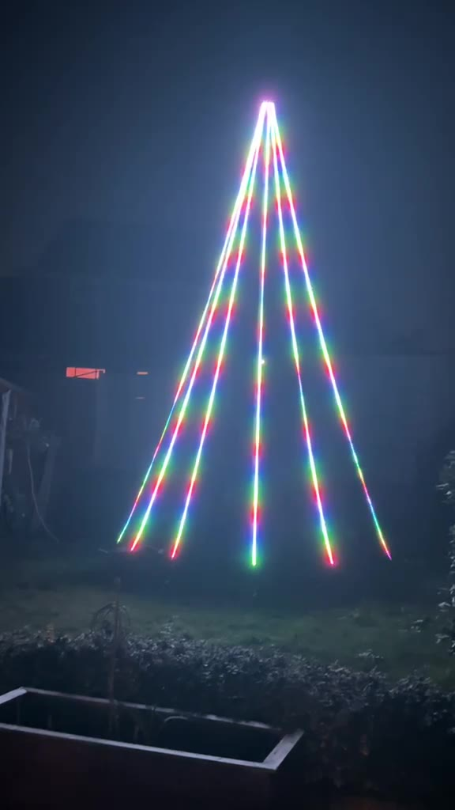
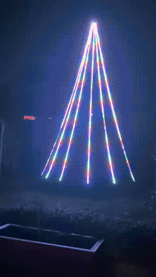
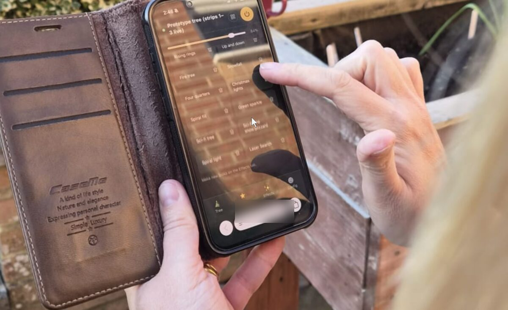
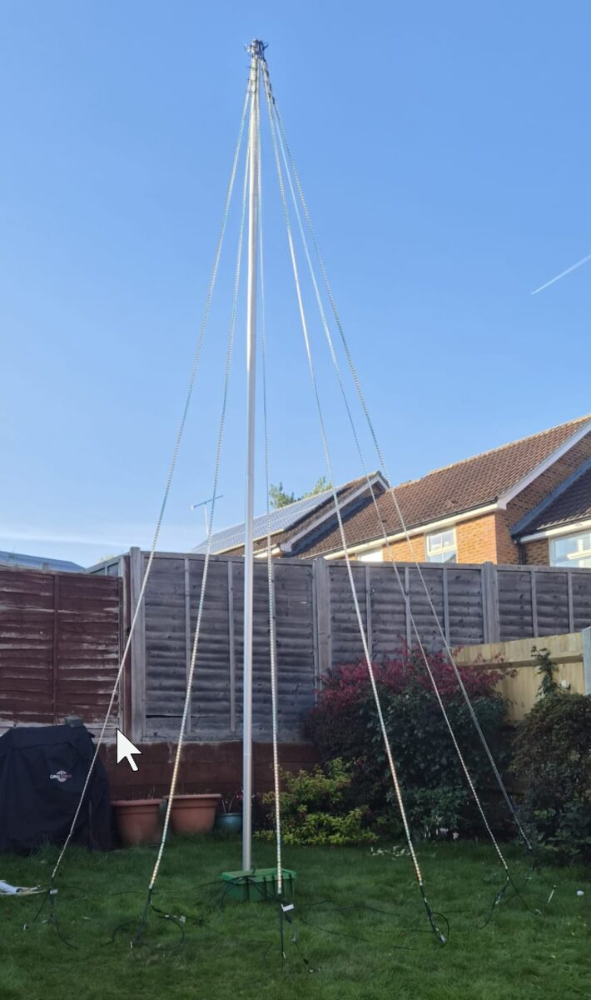
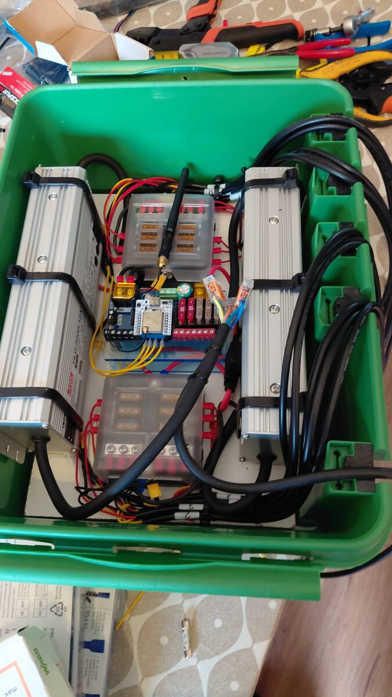
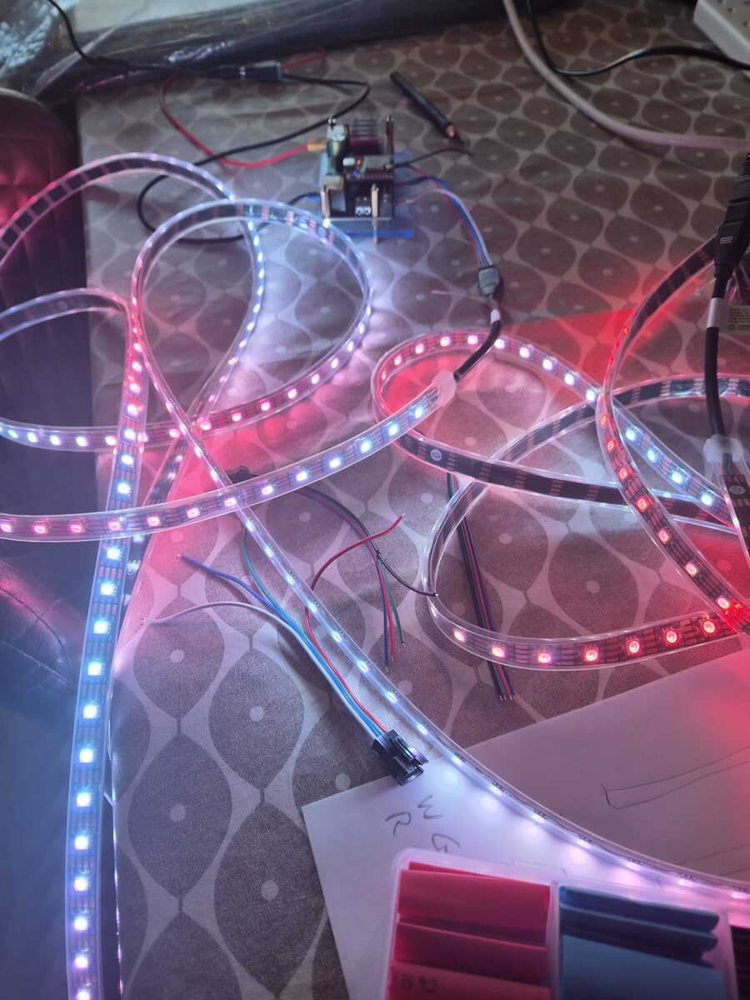

# Xmas Tree of Light

An outdoor **5–6 m cone Christmas tree** made of 12 vertical LED-strips (**3,600 addressable pixels**), run by a single ESP32 controller and controlled from a phone. It needs no laptop at the tree: looks and shows are stored on the controller and play by themselves, with a phone app as the remote.

<p align="center">
  
  
  
</p>

▶ Videos: [a tour of the looks in a show](docs/media/tree-show-tour.mp4) (1 min 45 s) · [first light](docs/media/tree-first-light.mp4) (18 s)


## How it works

Two words used throughout: an **LED-strip** is one 5 m strip of 300 LEDs (there are 12), and a **tree-strip** is three LED-strips joined end to end by their data wires, 15 m and 900 LEDs, on one controller output (there are 4). See [LED-strips and tree-strips](docs/build.md#led-strips-and-tree-strips).

| Layer | What |
|---|---|
| **Pixels** | 12 × 5 m **WS2815** 12 V LED-strips (60 LEDs/m, 300 px each), hung between a top ring and a base ring around a centre mast. Each LED-strip is fed from the bottom. |
| **Controller** | QuinLED **Dig-Quad V3** (ESP32) running **WLED 0.14**. There are 4 outputs, each driving one **tree-strip**: 3 LED-strips joined in a zig-zag (up, down, up). |
| **Power** | 2 × Mean Well HLG-320H-12A supplies in a box at the base, 6 LED-strips each, through two separate 6-way fuse boxes, one per supply (5 A per LED-strip). |
| **Software** | A single-file **phone app** served from the controller itself, and a C# **TreeTool** that applies the configuration from version-controlled files. |

```
 config/tree.json ──► TreeTool ──► WLED /json/cfg    (LED outputs, current limiter, boot preset)
 config/looks.json             ──► WLED /json/state  (one segment per strip, looks, shows)
                               ──► WLED filesystem:  /tree.htm + /tree.json
 Phone ── Wi-Fi ──► http://xmastree.local/tree.htm ──► WLED JSON API
```

On the home Wi-Fi the controller answers at `xmastree.local` (Android phones need its IP address). If it can't find that network at boot, it falls back to its own access point, `WLED-AP`, at `http://4.3.2.1/`.

## Using it

Open `http://xmastree.local/tree.htm` on a phone on the home Wi-Fi and use "Add to Home Screen" for an app icon. The **[user guide](docs/user-guide.md)** walks through every screen with screenshots:

| | |
|---|---|
| **Tree** | a rotating 3D preview of what the tree is showing, and a colour wheel |
| **Shows** | start, pause and stop shows, build new ones from saved looks, and set a daily start and lights-off time |
| **Effects** | pick from the A–Z effect list, set palette, colours, speed and intensity, and save the result as a look |
| **Config** | pick LED-strips or groups (North/East/South/West, odd, even), switch networks, share a QR code, see the controller's status |

## Safety

This is a tall structure outdoors, powered from the mains, in winter weather. Read this before building or switching on.

**The structure**
- **Fasten the mast securely** in its own right: a proper ground socket or base, plus guy lines where needed. **Never rely on the tension in the LED-strips** to hold the mast up; they are not structural and will stretch, slip or tear.
- **Do not erect, take down or use the tree in high winds.** Check the forecast, and switch it off and secure or lower it if strong winds are due.
- **Rope off the base of the tree** and keep small children and pets away from the mast, the guy lines, the base box and the cables.
- Check the mast, fixings and LED-strip ties before every season and after any storm.

**Electrical**
- **Only buy IP67-rated, marine-quality components** for anything outdoors: LED-strips, cable, connectors, glands and the enclosure. Indoor-rated parts will let water in.
- **Power the supplies through an RCD** (residual current device), either a fixed RCD-protected outdoor socket or a plug-in RCD, and test it before each use.
- Have the mains side (plugs, leads and the supplies' AC wiring) checked by a qualified electrician before the first power-up.
- Unplug the mains before opening the base box or touching any wiring.
- Keep every LED-strip on its own 5 A fuse, and only replace a fuse with one of the same rating.
- **Join all the grounds; never join the +12 V outputs** of the two supplies (see the warning under [The build](#the-build)).
- Keep the base box ventilated so the supplies can shed heat, with cable entries only in its bottom face and a drip loop on every cable.
- Run ground cables in protector or conduit so nobody trips over them or catches them with a mower.

The [build guide](docs/tree-wiring-build-guide.md) has the full rules for the wiring.

> **Disclaimer.** This is a personal hobby project, shared for information only and provided "as is" with no warranty. Anything you build or do with it is entirely at your own risk, and to the fullest extent permitted by law the author accepts no responsibility or liability of any kind. See [DISCLAIMER.md](DISCLAIMER.md) for the full terms.

## The build

> ⚠️ **All grounds must be wired together.** Both supplies' V−, both fuse boxes' negative buses, the Dig-Quad and the ground wire in every data lead and jumper all meet at one ground bar. The data signal is measured against ground, so an LED-strip whose ground isn't joined to the controller's sees no clean signal: expect flicker, wrong colours or a dark tree-strip. (The +12 V outputs are the opposite: never join them.)

<p align="center">
  
  
  
</p>

In short: a centre mast carries 12 LED-strips from the top down to the ground, each 5 m long and fed with power and data at the bottom. A box at the base holds the two 12 V supplies (one for LED-strips 1–6 and the controller, one for LED-strips 7–12), a 6-way fuse box for each, and the Dig-Quad controller. The two supplies share ground but their 12 V outputs are never joined, and LED-strip power never runs through the controller board.

The full build story, with wiring diagrams, guides, the parts list and the photos, is in **[docs/build.md](docs/build.md)**.

## TreeTool

A .NET command-line tool in `tools/TreeTool` that sets the controller up from the files in `config/`: LED outputs, one segment per LED-strip, the look library and shows, and the phone app itself. It backs the board up before every change.

```powershell
dotnet run --project tools/TreeTool -- <info|backup|plan|apply|upload|looks|test|serve> [--layout config/tree.json] [--yes]
```

See [docs/software.md](docs/software.md) for each command.

## Repository layout

| Path | Contents |
|---|---|
| `app/` | The phone app (`tree.htm`) |
| `config/` | Tree layouts (`tree.json` for the full tree, `bench*.json` for test rigs) and the look library (`looks.json`). See [config/README.md](config/README.md). |
| `tools/TreeTool/` | The C# configuration tool |
| `docs/` | The user guide, build docs, design, power and wiring notes, and the roadmap. Start at [docs/README.md](docs/README.md). |
| `skill/xmas-tree/` | A Claude skill with scripts for checking, reporting on and backing up the controller |

The docs use placeholders for local network details: `<home-wifi>`, `<board-ip>` and `<pc-ip>`.

## Status

**Built and running for Christmas 2026.** All 12 LED-strips are up on the mast, powered from the base box and running looks and shows from the phone app. See [docs/roadmap.md](docs/roadmap.md).

Possible next steps include mapping the tree as a WLED 2D matrix (12 × 300) for effects that wrap around it, such as scrolling text, fire and rain.

## Credits

- [WLED](https://kno.wled.ge/) firmware
- [QuinLED](https://quinled.info/) Dig-Quad controller
- [qrcode-generator](https://github.com/kazuhikoarase/qrcode-generator) 1.4.4 (MIT), built into the app

## Licence

MIT - see [LICENSE](LICENSE). The phone app embeds [qrcode-generator](https://github.com/kazuhikoarase/qrcode-generator) 1.4.4 (MIT).
