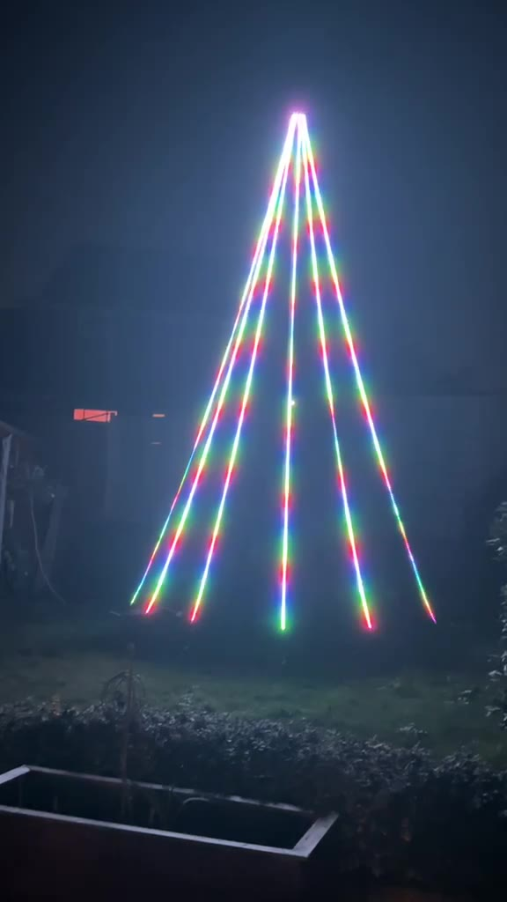
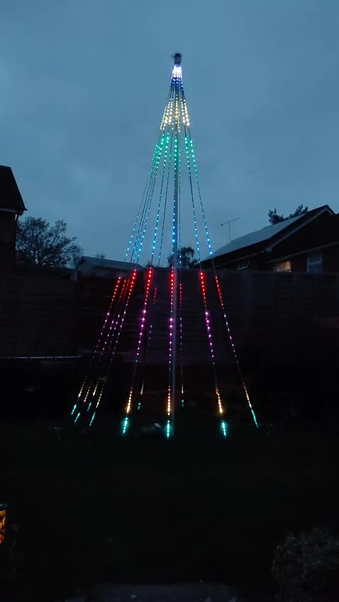
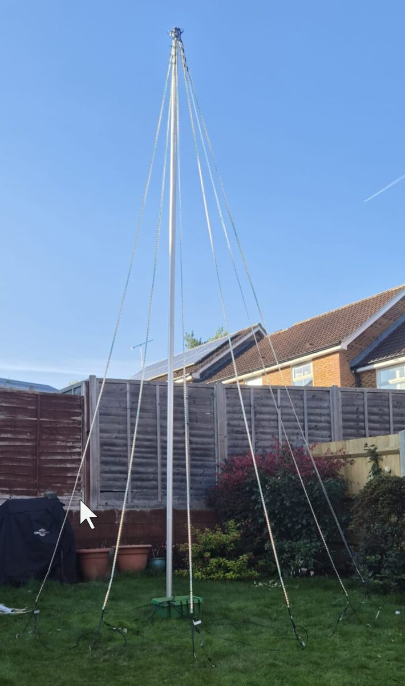
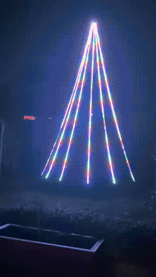
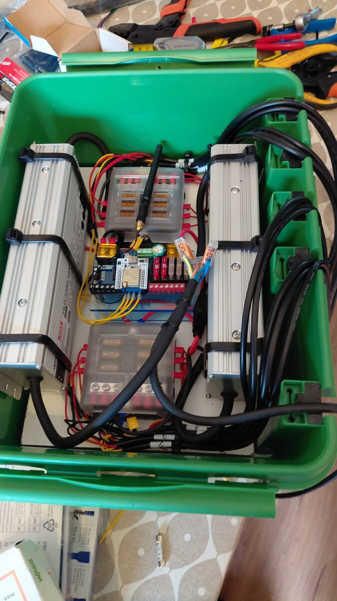
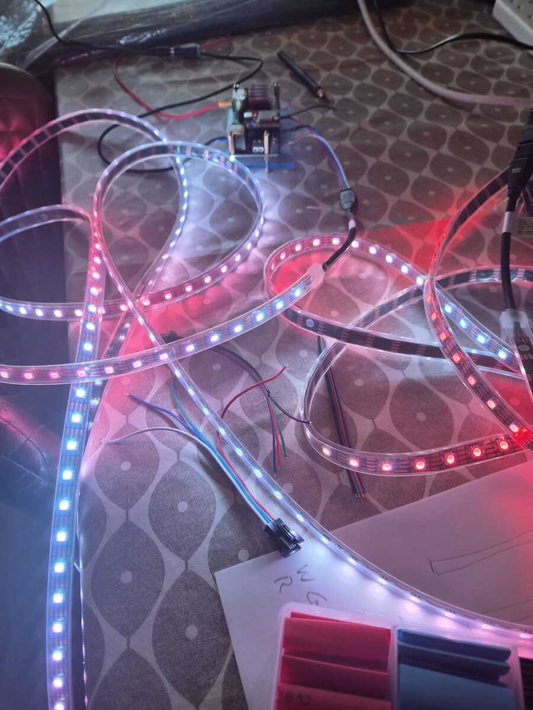
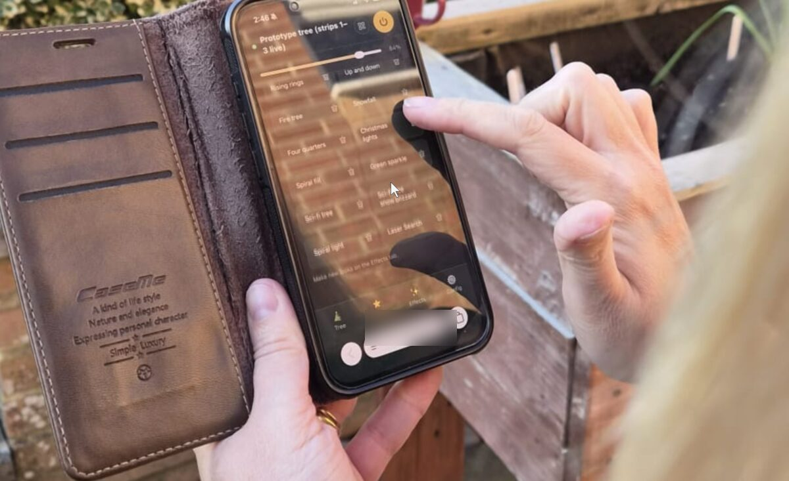

# Building the tree

How the tree is made: the hardware, the wiring and the build, with photos of the finished result. For using the tree once it is built, see the [user guide](user-guide.md).

> ⚠️ **All grounds must be wired together.** Both supplies' V−, both fuse boxes' negative buses, the Dig-Quad and the ground wire in every data lead and jumper all meet at one ground bar. The data signal is measured against ground, so an LED-strip whose ground isn't joined to the controller's sees no clean signal: expect flicker, wrong colours or a dark tree-strip. (The +12 V outputs are the opposite: never join them.)

  
  

## LED-strips and tree-strips

The word "strip" can mean two different things on this tree, so the docs use two names:

| Name | What it is | How many |
|---|---|---|
| **LED-strip** | One 5 m WS2815 strip, exactly as it comes off the reel: 300 LEDs. Each hangs from the top ring to the base ring, has its own power cable and its own 5 A fuse. Numbered 1–12 clockwise seen from above. | 12 |
| **Tree-strip** | Three LED-strips joined end to end by their data wires in a zig-zag (up, down, up), so they act as one 15 m, 900-LED string on one Dig-Quad output. Only the **data** runs the whole 15 m; each LED-strip in it is still powered separately at its own bottom end. | 4 |

| Tree-strip | Dig-Quad output | LED-strips | Supply and fuse box |
|---|---|---|---|
| 1 | LED1 (GPIO 16) | 1 ▲, 2 ▼, 3 ▲ | PSU 1, fuse box A |
| 2 | LED2 (GPIO 3) | 4 ▲, 5 ▼, 6 ▲ | PSU 1, fuse box A |
| 3 | LED3 (GPIO 1) | 7 ▲, 8 ▼, 9 ▲ | PSU 2, fuse box B |
| 4 | LED4 (GPIO 4) | 10 ▲, 11 ▼, 12 ▲ | PSU 2, fuse box B |

▲ data runs up, ▼ data runs down. A jumper at the top joins the first and second LED-strip of each tree-strip, and one at the bottom joins the second and third. The phone app and WLED work in LED-strips: the app's 12 "strips" are the 12 LED-strips, and WLED has one segment per LED-strip.

## The design in brief

| Part | What is used |
|---|---|
| **LED-strips** | 12 × 5 m BTF-LIGHTING WS2815 12 V LED-strips, 60 LEDs/m, IP67: 300 LEDs each, 3,600 in total ([LED-strip spec](strip-spec-ws2815.md)) |
| **Mast** | A centre pole about 5–6 m tall. The LED-strips hang from a ring at the top to a ring round the base, numbered 1 to 12 clockwise seen from above. |
| **Controller** | QuinLED Dig-Quad V3 (ESP32) on WLED 0.14.0. Each of its 4 outputs drives one tree-strip: 3 LED-strips in a zig-zag, up, down, up. |
| **Power** | 2 × Mean Well HLG-320H-12A (12 V, 22 A). PSU 1 feeds LED-strips 1–6 and the Dig-Quad (through a 2 A inline fuse); PSU 2 feeds LED-strips 7–12. |
| **Fusing** | **Two separate 6-way fuse boxes**, one for each supply: fuse box A on PSU 1 (LED-strips 1–6), fuse box B on PSU 2 (LED-strips 7–12). Each LED-strip has its own 5 A fuse. The Dig-Quad has a 2 A inline fuse from PSU 1. |
| **Feeds** | Every LED-strip is fed with power and data at its **bottom**, by its own cable from the base box. Jumpers at the top and bottom carry data from LED-strip to LED-strip. |

Rules that never change:

- The +12 V outputs of the two supplies are **never** joined.
- Every ground **is** joined: both supplies, both fuse boxes and the Dig-Quad meet at the ground bar.
- LED-strip power never goes through the Dig-Quad. Its LED outputs carry data and ground only.

## Photos

### The tree on the mast

The 12 LED-strips run from the top of the mast out to the base ring, forming the cone. Lit at night it looks like this:

Videos: [a tour of the looks in a show](media/tree-show-tour.mp4) (1 min 45 s) and [first light](media/tree-first-light.mp4) (18 s). The animation below is the first 14 seconds of the tour:

### The base box

Inside the box: the two HLG-320H-12A supplies on the left and right, the two separate 6-way fuse boxes in the middle, one for each supply (one above the controller, one below), and the Dig-Quad controller between them. The wiring is set out step by step in the [build guide](tree-wiring-build-guide.md).

### Bench testing

Before rigging, the LED-strips were tested on the bench, wired to the Dig-Quad, to check colours, data direction and the current drawn by a LED-strip at full white. See the [one-LED-strip prototype](prototype-one-strip.md).

### The phone app

The tree is run from a phone. See the [user guide](user-guide.md).

## Build documents

### Interactive pages

These open in the browser, served by GitHub Pages:

| Page | What it shows |
|---|---|
| [**3D tree wiring**](https://alearian.github.io/Xmas-Tree-Of-Light/docs/tree-wiring-3d.html) | An animated 3D model of the tree: LED-strips, power and data cables, and the base box. Drag to orbit, scroll to zoom. |
| [**Dig-Quad wiring diagram**](https://alearian.github.io/Xmas-Tree-Of-Light/docs/dig-quad-wiring.html) | The 12-LED-strip build: what connects to each controller terminal, supply, fuse box and LED-strip |
| [**One-LED-strip bench wiring**](https://alearian.github.io/Xmas-Tree-Of-Light/docs/prototype-one-strip.html) | The bench prototype: one LED-strip powered through the controller |

### Wiring guides

- [Tree wiring build guide](tree-wiring-build-guide.md) ([PDF](tree-wiring-build-guide.pdf)): the step-by-step build with 2 supplies, 6 LED-strips each, in the order to do the work
- [Dig-Quad connections](dig-quad-connections.md): the 12-LED-strip connection list, with wire and fuse sizes
- [Power and wiring](power-and-wiring.md): power and data wiring, feeds, fusing and joints, and how the design was settled
- [One-LED-strip prototype](prototype-one-strip.md): bench wiring and test steps
- [QuinLED Dig-Quad guide](quinled-dig-quad-guide.md): ratings, pinout and WLED settings

### Parts

- [Bill of materials](bom.md): the shopping list for the tree, with what each part is for
- [Parts checklist](bom-checklist-no-prices.md): what was bought
- [WS2815 LED-strip spec](strip-spec-ws2815.md): the LED-strip used, with its current draw

### Setting up the controller

Once the hardware is wired, the controller is set up from the files in `config/` with TreeTool: `apply` writes the LED outputs and one segment per LED-strip, `looks` saves the look library and shows, and `upload` puts the phone app on the board. See [software.md](software.md).

### Background

- [Design summary](design-summary.md): the numbers and the target WLED config in one place
- [Wiring options: 15 m vs 5 m LED-strips](wiring-options-15m-vs-5m.md) and [three LED-strips on direct power](three-strips-direct-power.md): options considered before the final design
- [Open questions](open-questions.md): the conflicts found in the original documents and how they were settled
