# Xmas Tree app: user guide

The tree is run from a web app that lives on the tree's controller. There is nothing to install: open it in the phone's browser and, if you like, add it to the home screen. It works on phones, tablets and PCs, and needs no internet connection, only the home Wi-Fi (or the tree's own Wi-Fi).

> **About the screenshots.** They were taken from app version 2026-10-25f running against a simulated controller loaded with the tree's real looks, shows and effect list, because the tree wasn't reachable when the guide was written. The tree preview in the screenshots is drawn by the simulator, so the colours are illustrative. Addresses shown are examples.

## Contents

1. [Opening the app](#1-opening-the-app)
2. [The top bar](#2-the-top-bar)
3. [Tree tab](#3-tree-tab)
4. [Shows tab](#4-shows-tab)
5. [Effects tab](#5-effects-tab)
6. [Config tab](#6-config-tab)
7. [Sharing the app](#7-sharing-the-app)
8. [Tablets and PCs](#8-tablets-and-pcs)
9. [Troubleshooting](#9-troubleshooting)

## 1. Opening the app

On a phone connected to the home Wi-Fi, open:

- `http://xmastree.local/tree.htm` on an iPhone, iPad or PC
- `http://<board-ip>/tree.htm` on Android, which can't find `.local` names (use the tree's IP address)

Then use **Add to Home Screen** (Safari: Share ▸ Add to Home Screen; Chrome: ⋮ ▸ Add to Home screen) so it opens like an app.

If the tree can't find the home Wi-Fi when it starts, it makes its own network, **WLED-AP**. Join that on the phone and open `http://4.3.2.1/tree.htm`. Each home-screen icon opens one address, so add one for each network you use.

The quickest way to get someone else connected is the [QR code](#7-sharing-the-app).

## 2. The top bar

The top of every screen has the same controls:

| Control | What it does |
|---|---|
| **Green dot** | The connection light. Green means the app is talking to the tree; grey means it can't reach it. |
| **QR button** | Shows a QR code for the app's address, so another phone can open it ([section 7](#7-sharing-the-app)) |
| **Power button** | Turns the whole tree on or off. It is gold when the tree is on. |
| **Brightness slider** | Sets the brightness for the whole tree, as a percentage |

Along the bottom are the four tabs: **Tree**, **Shows**, **Effects** and **Config**.

> **Strips in the app.** The tree has 12 **LED-strips** (single 5 m strips, numbered 1–12) joined in threes into 4 **tree-strips** (see [build.md](build.md#led-strips-and-tree-strips)). Wherever the app says "strip", as in the Strips picker, **All strips** or **Reset strip layout**, it means one LED-strip.

## 3. Tree tab

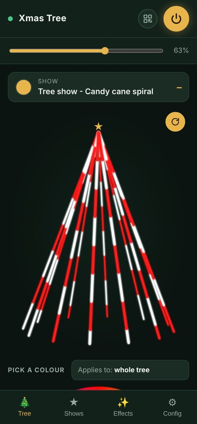 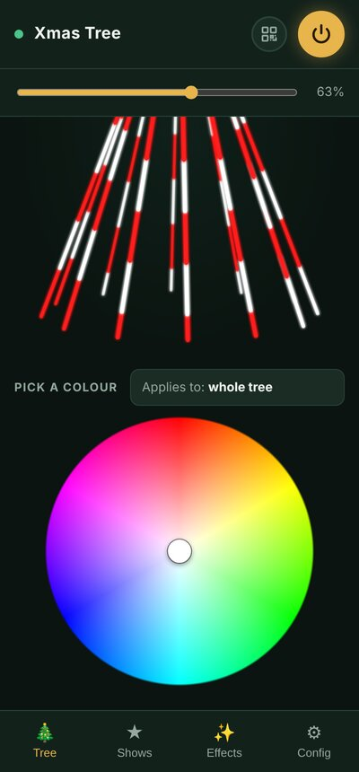

**Now showing.** The card at the top says what the tree is doing: the show and the look within it (here "Tree show – Candy cane spiral"), or just the look if no show is running. While a show runs, the right of the card counts down the time left on the current look, and on wider screens it also names the next look. When a show is paused, a ▶ play button appears there to resume it.

**3D preview.** Below is a live picture of the tree, drawn from what the controller is actually sending to the LED-strips. It turns slowly; tap the round arrow button to stop or start the rotation.

**Pick a colour.** Scroll down for the colour wheel. Touch or drag on it to set a solid colour straight away. "Applies to" shows where the colour goes: the whole tree, or only the LED-strips picked on the [Config tab](#strips-and-groups). Picking a colour stops any show that is running.

## 4. Shows tab

A **look** is a saved effect with its colours and settings, such as "Candy cane spiral". A **show** is a list of looks played one after another, each for a set time, with a fade between them.

### Running a show

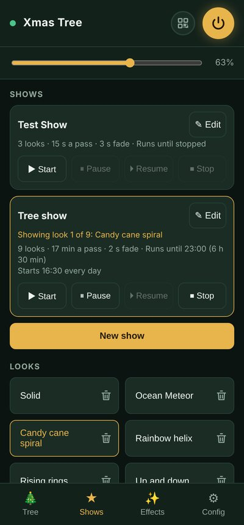

Each show has a card with its summary: how many looks, how long one pass takes, the fade, how long it runs and, if it has one, its daily start time. The card of the running show is outlined in gold and says which look is showing.

| Button | What it does |
|---|---|
| **Start** | Starts the show from its first look |
| **Pause** | Stops changing looks and holds the current one |
| **Resume** | Carries on from the look it was paused on |
| **Stop** | Ends the show and turns the lights off |
| **Edit** | Opens the show editor |

### Looks

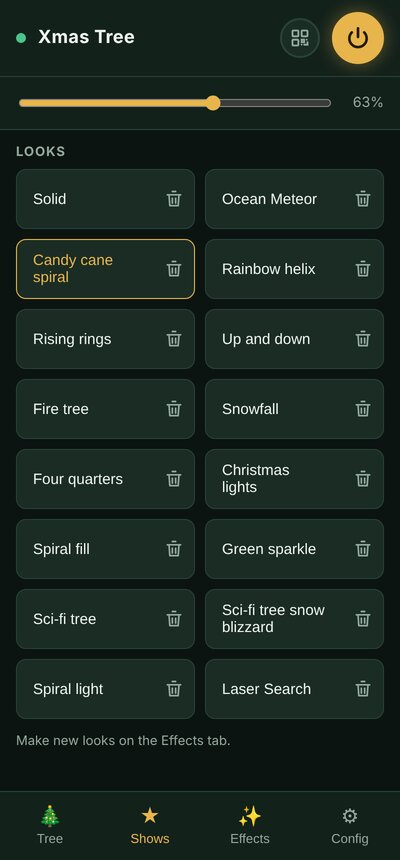

Scroll down for every saved look. Tap a look to show it on the tree (this stops any show). The look showing now is outlined in gold. The bin button deletes a look; the app asks first. New looks are made on the [Effects tab](#5-effects-tab).

### Making or editing a show

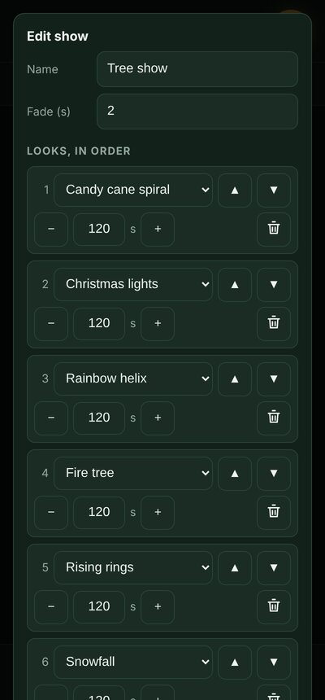 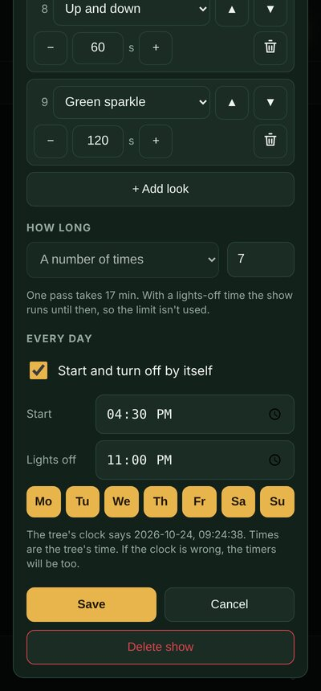

Tap **New show**, or **Edit** on a show's card.

1. **Name** the show and set the **Fade**, in seconds, between one look and the next.
2. Under **Looks, in order**, pick a look in each row and set how many seconds it shows for with − and +. The ▲ ▼ buttons move a row up or down and the bin removes it. **+ Add look** adds a row.
3. Under **How long**, choose **Forever**, **For a number of hours**, or **A number of times** (passes through the list). The note underneath says how long one pass takes.
4. Under **Every day**, tick **Start and turn off by itself** to schedule the show. Set the **Start** time, the **Lights off** time and the days it runs (gold days are on). The note shows the tree's own clock, which the timers use; if it is wrong, the times will be too.
5. Tap **Save**. **Delete show** removes the show and its schedule.

## 5. Effects tab

This is where new looks are made. Pick an effect, adjust it on the live tree, then save it.

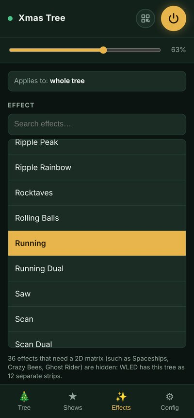 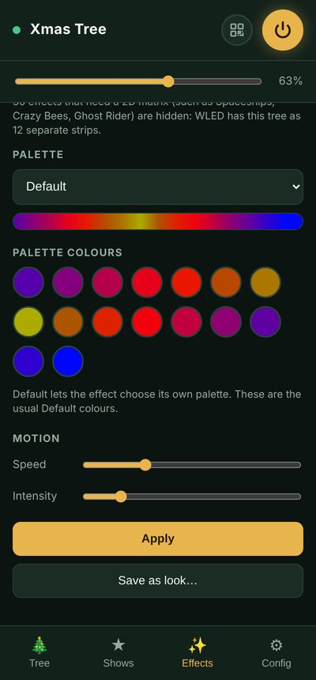

1. **Applies to** at the top says whether changes go to the whole tree or to the LED-strips picked on the Config tab.
2. **Effect.** Scroll the A–Z list, or type in **Search effects…** to narrow it down. The effect showing now is highlighted in gold. Effects that only work on a 2D grid are hidden, and a note at the bottom of the list says how many.
3. **Palette.** Choose a colour palette for effects that use one. The bar underneath shows its colours.
4. **Colours.** For effects that use set colours, tap a colour to change it. The note says which colours the effect uses.
5. **Motion.** **Speed** and **Intensity** change how fast the effect moves and how busy it is; what "intensity" means depends on the effect.
6. Tap **Apply** to send it to the tree.
7. Tap **Save as look…** and give it a name to keep it. It then appears under Looks on the Shows tab, ready to use in a show.

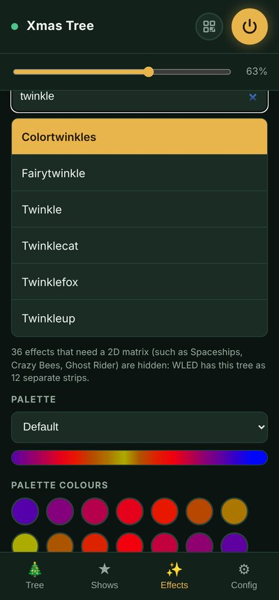

The tree has room for a limited number of looks. If the app says there is no room, delete a look you no longer use.

## 6. Config tab

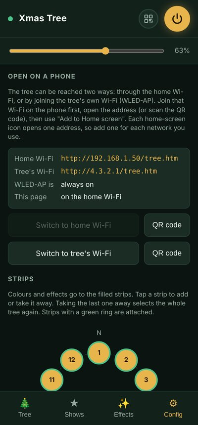

### Open on a phone

The addresses of the app on the home Wi-Fi and on the tree's own Wi-Fi, whether WLED-AP is always on, and which network this page is using. **Switch to home Wi-Fi** and **Switch to tree's Wi-Fi** open the app on the other address (join that Wi-Fi first). Each **QR code** button shows a code for that address.

### Strips and groups

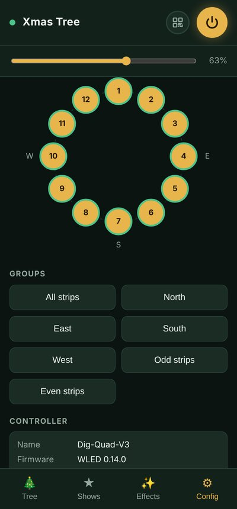

The circle is the tree seen from above, with the 12 LED-strips numbered clockwise and N, E, S, W marking the sides. Filled (gold) LED-strips are the ones colours and effects go to. Tap a LED-strip to add it or take it away; taking the last one away selects the whole tree again. A green ring means the LED-strip is attached.

The **Groups** buttons pick a set in one go: **All strips**, **North**, **East**, **South**, **West**, **Odd strips** or **Even strips**. Then go to the Tree tab for a colour or the Effects tab for an effect.

### Controller

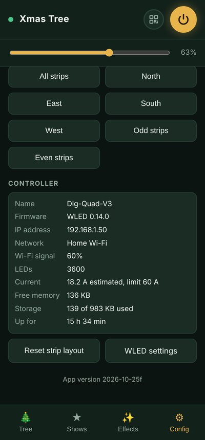

The controller's name, firmware, IP address, network, Wi-Fi signal, number of LEDs, estimated current and limit, free memory, storage used and how long it has been running.

- **Reset strip layout** puts every LED-strip back to the saved layout. Use it if the LED-strips stop behaving as twelve separate LED-strips. It replaces the current look.
- **WLED settings** opens the controller's own settings pages. Change these only if you know what you are doing: a wrong network setting can lock you out.

The **App version** at the bottom tells you which copy of the app the phone has loaded.

## 7. Sharing the app

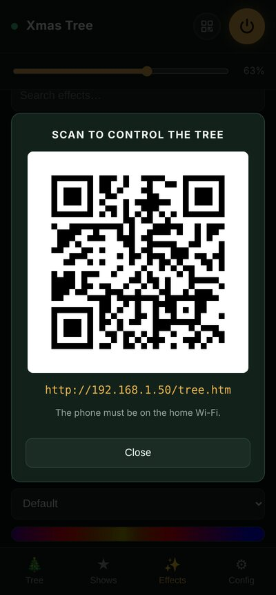

Tap the QR button in the top bar. Another phone on the same Wi-Fi scans the code with its camera and opens the app. The screen stays on while the code is showing. Tap **Close** when done.

## 8. Tablets and PCs

On a wide screen in landscape, the tabs lay out side by side: the preview next to the colour wheel, and the effect list next to its settings.

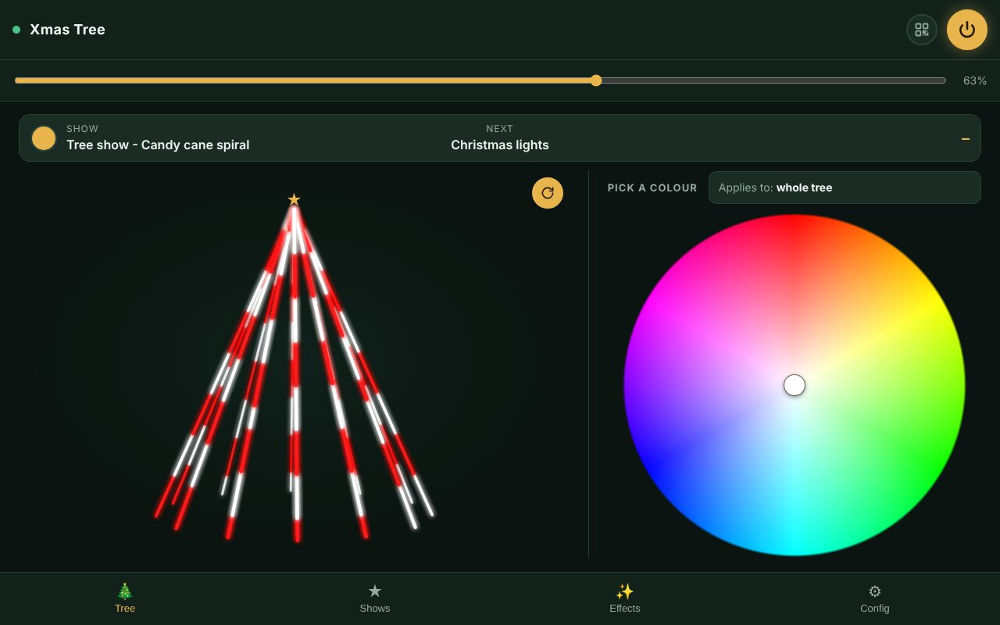

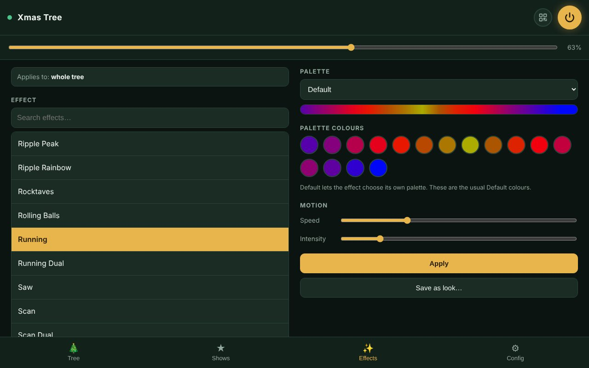

## 9. Troubleshooting

| Problem | What to try |
|---|---|
| The app won't open on Android | Use the IP address instead of `xmastree.local` |
| The connection dot is grey | Check the phone is on the home Wi-Fi (or on WLED-AP when using `4.3.2.1`). If the tree has just been powered on, give it a minute. |
| The app looks out of date after an update | Compare the **App version** on the Config tab; close the tab or app and open it again to load the new copy |
| The tree didn't come on at the scheduled time | Check the clock shown in the show editor, and that the show's days are ticked |
| Effects only change some LED-strips | LED-strips are picked on the Config tab; tap **All strips** |
| The LED-strips no longer act as twelve separate LED-strips | Config tab ▸ **Reset strip layout** |
| "No room for another look" | Delete a look you don't use on the Shows tab |
